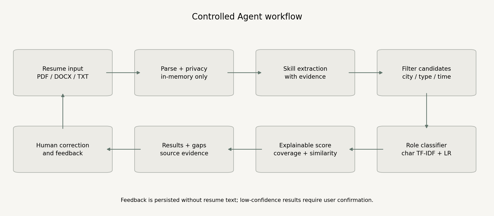
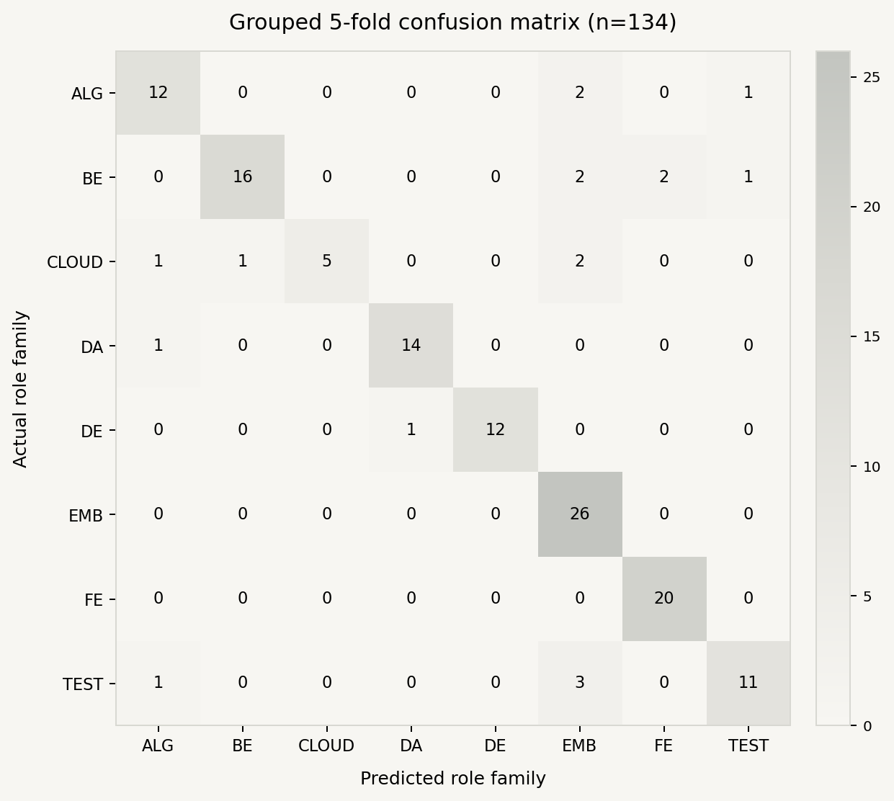
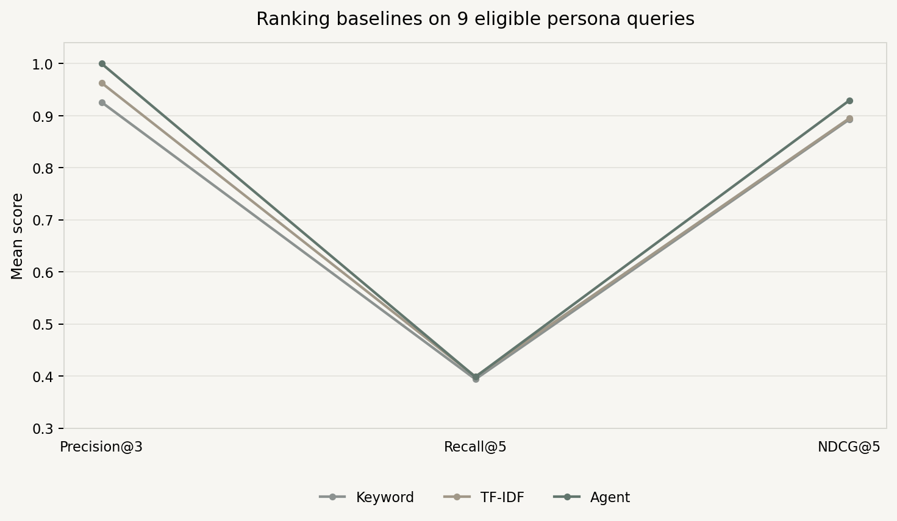

# 面向多类技术岗位的简历匹配与技能差距分析 Agent

课程：机器学习  
姓名：________  
学号：________  
组员及分工：________  
日期：2026 年 11 月 6 日

## 摘要

本项目面向计算机、数据与电子信息相关专业学生，构建一个可在本地运行的岗位匹配与技能差距分析 Agent。系统允许用户上传 PDF、DOCX 或 TXT 简历，选择目标岗位方向、城市、招聘类型、经验年限与发布时间，再结合本地岗位库输出岗位排序、技能匹配、未找到技能及对应原文证据。项目将岗位分类模型、技能覆盖、文本相似度和用户筛选条件整合到可解释的 Agent 工作流中，并提供低置信度方向确认、技能人工确认和岗位不相关反馈。当前有效岗位库包含 222 条岗位，覆盖八个技术方向。八分类模型在按公司分组交叉验证中的 Macro-F1 为 0.8550。在 9 个候选岗位充足的评估画像上，Agent 的 Precision@3 为 1.0000、NDCG@5 为 0.9291，高于关键词和 TF-IDF 基线；该结果用于课程内相对比较，不代表对所有求职者的普遍效果。

关键词：岗位匹配；技能差距；Agent；文本分类；可解释排序

## 1 需求与目标

学生在寻找实习和校招岗位时，需要同时处理大量岗位描述、不同技术栈、城市和招聘类型。岗位标题并不能完整反映实际要求，同一技能也会在后端、算法、测试和嵌入式岗位之间交叉出现。人工筛选通常存在三个问题：岗位数量多、技能要求分散、难以判断简历中的哪些表达能够作为能力证据。

本项目将一个具体任务限定为：给定一份简历和若干求职偏好，从本地岗位库中选出更匹配的岗位，指出简历与岗位之间的技能差距，并给出依据。系统服务于求职者自我分析，不用于企业筛人，也不自动投递，不将匹配分解释为录用概率。

目标用户是正在准备技术类实习或初级校招的本科生和研究生。典型使用情境包括：第一次整理求职简历、在多个岗位之间排序、针对一个岗位补充项目描述，以及检查自己是否缺少某项关键技术。系统需要把岗位职责与任职要求中的技能整理出来，再与简历逐项对应，并把结论还原到原始句子，避免只给出没有依据的分数。

实际使用时，用户先建立技能画像，再调整岗位方向与城市、招聘类型等硬性条件，最后查看岗位排序和技能缺口。系统应保留“为什么推荐”“为什么未找到”和人工确认入口；当证据不足或用户不认可结果时，应提示不确定性，而不是生成看似精确却无法追溯的结论。

成功标准包括：

1. 八类岗位能够被识别和筛选；
2. 岗位匹配结果附带技能证据和原始岗位链接；
3. 八分类模型在分组交叉验证中明显优于基础基线；
4. Agent 排序在固定评估画像上优于关键词和 TF-IDF 基线；
5. 用户能够修正错误方向、确认实际具备的技能，并反馈不相关岗位；
6. 完整流程可在本地复现并通过自动化测试。

## 2 方案与系统设计

系统采用可控制的顺序工作流，不依赖多 Agent 协作，也不把通用大模型调用作为核心能力。主要步骤为：

1. 读取并解析 PDF、DOCX 或 TXT 简历；
2. 对邮箱、手机号等风险内容给出隐私提示；
3. 识别字符串级技能与证据；
4. 根据用户选择的岗位方向、城市、招聘类型、经验年限和时效筛选岗位；
5. 使用八分类模型计算岗位方向一致度；
6. 计算技能覆盖率、命中强度、方向核心能力与文本相似度；
7. 融合模型结果生成可解释排序；
8. 对低置信度结果、缺失技能和岗位不相关反馈请求人工确认；
9. 保存不含简历正文的反馈记录，用于后续排序降权。



输入为简历与筛选条件，输出为技能画像、岗位排序、匹配证据和技能缺口。系统先按城市、招聘类型、经验年限和发布时间形成候选集，再计算模型与技能分，避免社招资历要求混入应届结果。岗位卡片同时展示必备技能覆盖、文本相似度、模型方向一致度、已匹配技能和未找到技能，使结果可被检查。

各步骤通过明确的数据结构衔接：解析器输出纯文本和风险提示，技能模块输出带原文例句的标准化技能集合，筛选器输出候选岗位编号，分类模型输出方向概率，匹配器再把上述结果组合为岗位卡片。任一步骤失败时，接口返回具体原因和可行替代操作；硬性筛选先于语义评分，防止相关度较高但城市或经验不符的岗位绕过用户条件。内容过短时展示三类示例简历，切换示例会同时更新文本和岗位方向，便于比较不同技术栈的识别结果。

| 组成 | 当前实现 | 在 Agent 中的职责 | 明确边界 |
|---|---|---|---|
| 模型 | 字符 TF-IDF + Logistic Regression | 估计岗位属于八个方向之一的概率，并提供方向一致度 | 不判断候选人是否应被录用 |
| 工具 | 本地解析器、筛选器、匹配器、反馈存储 | 解析简历、缩小候选集、计算覆盖率和保存纠正 | 只做用户发起的本地分析 |
| 数据 | 222 条结构化 JD、技能词表、评估画像 | 提供岗位、技能证据和实验样本 | 页面无开放数据许可证，不公开再分发原文 |
| 人机协作 | 方向确认、技能确认、岗位不相关反馈 | 修正模型或词典无法处理的情况 | 反馈只改变当前用户的排序，不训练在线模型 |

关键设计选择及其备选方案如下。选择依据是任务规模、可解释性、离线复现和隐私成本，而不是追求组件数量。

| 设计点 | 采用方案 | 备选方案 | 选择理由 |
|---|---|---|---|
| Agent 组织 | 固定顺序工作流 | 多 Agent 自主协作 | 任务边界清楚，固定流程更易测试、复现和定位错误 |
| 文本表示 | 字符级 TF-IDF | 神经语义向量或在线大模型嵌入 | 无需 API 和密钥，简历不离开本机，适合 134 条训练样本 |
| 技能识别 | 可解释规则词典与同义词模式 | 有监督多标签模型 | 当前缺少逐技能人工标注，规则能直接给出原文证据 |
| 排序融合 | 人工设定权重的可解释特征融合 | Learning-to-Rank | 相关标签规模小，固定权重更容易审查和解释 |

## 3 数据来源与处理

岗位数据来自腾讯招聘官网、河北工业大学就业指导中心、高校人才网等公开页面。原始库包含 307 条岗位。系统重新访问岗位链接并检查页面是否显示“已过期”“已下线”或错误状态，结果为 224 条可访问、82 条明确过期、1 条无法确认。经过重复记录、多职位拼接和字段完整性检查，最终保留 222 条可匹配岗位。

岗位方向覆盖后端、前端、算法、嵌入式、数据分析、数据开发、测试开发和云原生/SRE。可匹配岗位中包含 180 条社招、26 条校招和 16 条实习或校招实习岗位。不同采集页面的字段格式并不一致，因此项目增加了数据准备脚本，统一清理任职要求前的标点，提取经验年限，识别省级地点、缺失日期和多职位标题，并补充页面活跃状态与最近核验时间。

项目不收集求职者联系方式等个人信息。简历只在当前请求内存中处理，不写入磁盘。用户反馈仅保存岗位编号、技能键和方向修正，不保存简历原文。原始岗位页面没有明确开放数据许可证，因此数据只用于课程项目分析，不直接作为开放数据再次分发。

清洗过程中共处理 113 条任职要求前的标点残留，识别并排除 5 条将一个标题拼接成多个岗位的记录以及 1 条重复记录。对于来源只写到省份、城市缺失或日期缺失的记录，系统添加质量标记。清洗后的字段包括岗位方向、公司、城市、招聘类型、经验、职责、要求、技术关键词、来源、发布日期、核验时间和是否可匹配。

每条岗位保留来源名称、来源链接、发布日期、最近核验时间和状态，使后续过期检查可以重新执行。采集页面的正文用于生成结构化标签，匹配结果仍回链到原始页面；这样既能展示证据，也避免把清洗后的摘要误当作企业正式招聘公告。

## 4 机器学习方法

岗位分类器使用字符级 TF-IDF 表示岗位文本[1]，输入为岗位职责、任职要求和加分项，不直接使用岗位标题，避免标题信息泄漏。比较 Multinomial Naive Bayes 基线和带类别平衡的 Logistic Regression[2]，后者能输出各类别概率作为方向一致度。

| 组件 | 关键参数 | 设置目的 |
|---|---|---|
| TF-IDF | `analyzer=char_wb`、`ngram_range=(2,5)` | 适配中文技术文本，保留技能缩写、复合词和局部表达 |
| TF-IDF | `max_features=30000`、`sublinear_tf=True` | 控制词表规模并抑制高频词重复计数的支配作用 |
| Logistic Regression | `max_iter=3000`、`class_weight="balanced"`、`random_state=42` | 保证收敛、缓解类别不均衡并固定随机性 |
| 验证 | 按公司分组 5 折、`StratifiedGroupKFold` | 防止同一公司的相似模板同时出现在训练集和验证集 |

采用字符 n-gram 而不依赖中文分词，是因为岗位文本混合中文、英文缩写、框架名和符号，`Java`、`C++`、`React` 等词在分词不一致时容易丢失。2—5 字符片段可保留局部技术表达，同时 30000 个特征上限控制计算量。这里的训练标签是岗位方向，不是“候选人是否适合”，因此分类概率只作为排序特征，不能被解释为录用概率。

为避免同一公司大量相似模板同时进入训练和验证，训练数据按公司分组进行 5 折交叉验证，并限制“公司×岗位类别”的样本数量。222 条可匹配岗位经过公司级平衡后形成 134 条训练样本。分组验证结果如下：

| 方法 | Accuracy | Macro-F1 |
|---|---:|---:|
| Naive Bayes | 0.5000 | 0.3844 |
| Logistic Regression | 0.8657 | 0.8550 |

主模型 Macro-F1 明显高于基线[2]。随机分层参考的 Macro-F1 为 0.8142，与分组验证接近。混淆矩阵显示，云原生和测试开发仍有跨方向误分类：云原生类 9 条中 5 条正确，另有 2 条被判为嵌入式；测试开发类 15 条中 11 条正确，另有 3 条被判为嵌入式。



技能识别使用 41 个可解释标签和同义词模式；对容易出现误判的通用词进行了限制，例如普通 REST 调用不再直接视为后端能力，泛化的“搜索”“推荐”不再直接视为 NLP/CV 能力。

最终匹配分综合必备技能覆盖率、命中强度、方向核心能力、文本相似度和模型一致度。分类器只占 10% 权重，技能项占主要部分，因此模型不是唯一裁判。岗位没有加分项时，相应权重会被移除并重新归一化。排序还会限制同公司占位，并应用“不相关”反馈降权。

## 5 Skills 与组件复用

项目复用了 `anthropics/claude-plugins-official` 仓库中的 `frontend-design` Skill，固定提交版本为 `a1ecfbc7f138a0ef455088f7f28cda2d22a0f853`，许可证为 Apache-2.0[5]。该 Skill 提供视觉方向、排版、结构、可访问性和自检流程。项目保留了上游 `SKILL.md` 与 `LICENSE.txt`，没有修改原文；新增 `scripts/check_frontend_design_skill.py`，把设计说明转化为本项目可执行的确定性检查。因此，它是被适配为前端质量门的 Agent 设计 Skill，不是运行时大模型，也不负责岗位匹配预测。

检查内容包括：颜色、间距、圆角和阴影是否由 CSS 变量统一管理；是否出现渐变和发光效果；是否存在键盘焦点样式、减少动画偏好和移动端布局；页面是否只有一个主标题，品牌是否使用纯文字。14 项检查全部通过并保存为 `models/frontend_skill_report.json`。

复用过程固定上游提交并保留许可证，避免依赖持续变化；运行时只需本地文件，不把 Skill 暴露为用户输入或模型工具。该方式的优势是行为可验证、无外部 API 和密钥依赖；限制是自动检查只能验证设计约束，不能替代桌面端与移动端的人工视觉评审。

| 组件 | 来源与版本范围 | 许可证 | 功能与集成方式 | 修改与核验 |
|---|---|---|---|---|
| `frontend-design` | Anthropic；固定 commit `a1ecfbc7…` | Apache-2.0 | 将视觉与可访问性原则适配为本地检查 | 上游原文未改，新增 14 项检查 |
| Flask | `>=3.0,<4` | BSD-3-Clause | 本地 Web 与 JSON API[7] | 原样依赖，API 测试覆盖 |
| scikit-learn | `>=1.3,<2` | BSD-3-Clause | TF-IDF、逻辑回归、交叉验证[2] | 原样依赖，模型可复训 |
| pypdf | `>=5,<6` | BSD-3-Clause | 从文字型 PDF 提取简历文本[6] | 原样依赖，上传测试覆盖 |
| python-docx | `>=1.1,<2` | MIT | 读取 DOCX 简历、生成报告文档 | 原样依赖，解析测试覆盖 |
| NumPy、joblib | `>=1.24,<3`；`>=1.3,<2` | BSD-3-Clause | 数值计算与模型序列化 | 原样依赖 |
| ReportLab | `>=4,<6` | BSD-3-Clause | 生成提交版 PDF 报告 | 原样依赖，用于文档输出 |
| Matplotlib | `>=3.8,<4` | PSF/Matplotlib | 根据模型 JSON 生成报告图表 | 新增绘图脚本，无手工改数 |

完整许可证与来源清单见 `THIRD_PARTY_NOTICES.md`、`third_party/SKILL_USAGE.md` 以及独立的《复用组件与复现说明.pdf》。

## 6 实验设计与结果

### 6.1 测试集构造

实验分成岗位分类和岗位排序两部分。分类测试集采用公司分组五折交叉验证：先将“公司×岗位类别”限制为最多 4 条，避免相似模板跨训练集和验证集泄漏，再将 222 条有效岗位平衡为 134 条训练样本。

排序测试集包含 16 个求职者画像，每个方向各 2 个，覆盖校招、实习和不同年限要求。每个画像包含方向、招聘类型、最高经验年限、目标技能和一段模拟简历。相关性标签按目标技能与岗位必备技能的重合度分三级：命中至少 2 个目标技能且覆盖不低于 25% 记 2 分；命中至少 1 个目标技能且覆盖不低于 10% 记 1 分；其余记 0 分。对 29 个 query-job 对进行了 AI 辅助抽样复核。该标签是半自动 silver label，不是独立人工 gold set，最终仍应由真实学生确认。

### 6.2 指标与对照

使用 Precision@3、Recall@5 和 NDCG@5 比较三种方法[3][4]。Precision@3 检查前三名中有多少相关岗位；Recall@5 检查前五名覆盖了多少个已判定相关岗位；NDCG@5 同时考虑相关等级和位置，越相关的岗位越靠前得分越高。对照组为关键词覆盖排序和纯 TF-IDF 余弦相似度排序，实验组为 Agent 的混合排序。

16 个画像中有 7 个在校招、实习或经验条件筛选后不足 5 个候选岗位，只在明细中保留，不进入主指标平均；其余 9 个画像的候选数均不少于 5 个。这一处理避免零候选画像产生无意义的平均值，同时也说明严格筛选会带来候选池过小的问题。

为保证比较公平，三种方法共享同一批候选岗位、招聘条件和画像输入，差异只来自排序规则；主指标也只统计候选不少于 5 条的画像。实验仍然没有置信区间和独立测试集，因此只比较同一数据协议下的相对方向，不把小数差异解释为统计显著性。

### 6.3 结果

| 方法 | Precision@3 | Recall@5 | NDCG@5 |
|---|---:|---:|---:|
| 关键词基线 | 0.9259 | 0.3939 | 0.8927 |
| TF-IDF 基线 | 0.9630 | 0.3989 | 0.8948 |
| Agent 混合排序 | 1.0000 | 0.3984 | 0.9291 |



Agent 的前三项精确率和 NDCG@5 均高于两个基线，说明模型一致度、技能命中强度和必备技能覆盖的组合在该测试集上有效。Recall@5 与关键词基线接近，说明当前提升主要来自前列排序质量，而不是发现更多相关岗位。Precision@3 达到 1.0000 只说明这 9 个画像的前三名均被当前标签判为相关，不能外推为真实招聘场景中的普遍精确率。

### 6.4 结果解释边界

分类实验衡量方向识别，排序实验衡量给定简历后的相对顺序，二者不能互相替代。由于样本量、来源集中度和半自动标签的限制，本实验适合验证相对基线与失败模式，不足以证明生产环境效果。

## 7 错误分析与失败处理

第一，部分岗位描述包含多个招聘方向。当前通过标题长度、斜杠数量和“工程师”出现次数识别多职位拼接，数据清洗共排除 5 条多职位拼接记录和 1 条重复记录。这些记录无法可靠对应到单一岗位方向，保留会同时污染训练标签和技能覆盖率。

第二，现有分类器的残余误差集中在相近技术方向。混淆矩阵中，云原生岗位和测试开发岗位均有记录被判为嵌入式，原因是三者都可能出现 Linux、C/C++、接口、脚本和自动化等词汇。当前处理方式是保留概率，而不是把预测包装成确定结论；低置信度时由用户选择方向。

第三，同义技能和隐含技能仍可能漏检。例如简历只描述“训练分类模型”但没有直接写出机器学习名称时，规则词典可能无法识别。为此结果页允许用户点击技能缺口，确认“实际具备”后重新分析，但这属于用户自报信息，不能视为独立核验。

第四，技术词汇存在跨岗位复用。开发初期，前端页面调用 REST API 会错误触发后端技能，宽泛的“搜索”“推荐”也会错误触发 NLP/CV 标签。项目随后收紧了模式匹配，并要求技能证据存在于对应句子中；当前仍不能完全消除一词多义。

第五，严格筛选可能使候选岗位过少。16 个排序画像中有 7 个在校招、实习或经验条件下不足 5 个候选岗位。系统会在结果过少时提示放宽城市、经验、招聘类型或时间范围，并支持浏览完整有效岗位库。

第六，扫描型 PDF 没有可提取文本，系统会给出 OCR 或文本粘贴提示[6]；损坏、加密或超限文件也会返回明确错误，不静默失败。

系统错误处理遵循“说明原因、给出下一步”的原则。文件为空、格式不支持、PDF 无文本、筛选参数错误或没有候选岗位时，接口会返回可读信息。岗位不相关反馈会在后续请求中读取并对该岗位进行有限幅度降权；如果反馈文件中出现无效记录，程序会跳过该记录，不影响核心匹配流程。

## 8 讨论与改进

项目的现实价值在于降低求职者的第一轮信息整理成本。用户可在一个本地界面中看到岗位方向、技能覆盖、缺失技能和 JD 原文依据，并可对错误结果作修正。系统不依赖在线大模型，适合无法提供 API 密钥的课程演示；固定工作流也便于说明每个分数来自哪个工具或模型。这些价值属于求职辅助，不等于自动职业规划或录用判断。

风险与边界主要有四项。第一，匹配分表示当前简历对当前 JD 的文本和能力覆盖程度，不是录用概率。第二，岗位页面没有开放数据许可证，完整 JD 只用于课程分析，公开仓库前应确认再分发范围。第三，岗位会过期或变更，结果必须保留来源链接和核验时间。第四，简历即使只在内存中处理，也应避免在公共设备上传真实敏感信息。

当前局限包括：有效岗位中社招 180 条、校招 26 条、实习或校招实习 16 条，实习样本仍偏少；相关性标签是半自动构造，只复核了 29 个 query-job 对；技能词典对同义表达和隐含能力有限；扫描 PDF 尚不内置 OCR；系统是本地原型，没有账号、权限和在线并发保障。

若要部署为多人服务，还需增加账号隔离、反馈滥用防护、访问限流、日志脱敏和数据保留策略，并对模型与岗位数据版本化。本地原型用于证明流程和可解释性，不声称达到生产标准。

后续改进应优先补充真实学生反馈和人工技能片段标注，再扩充实习岗位与公司来源；在标注量足够后，可比较语义向量和 Learning-to-Rank，并加入链接巡检、过期提醒、OCR 与更细的隐私脱敏。任何新增模型都应继续报告失败案例和不确定性，不能只用平均分展示改进。

## 9 学术诚信与 AI 使用说明

本项目在资料梳理、代码起草与调试、报告整理、图表脚本和评审表复核中使用生成式 AI（Codex）。AI 输出不作为实验证据；所有数值由本地脚本重算并可由 JSON 复核，复用来源与许可证已列明。学生须亲自运行、核对并解释工作流、模型、排序公式和关键代码；半自动标签不得表述为完全人工标注。项目不写入简历正文，不提交账号密钥或未经许可的岗位原文，学术规范以课程现行要求为准。

## 10 参考文献与附录

### 10.1 参考文献

1. Salton G, Buckley C. Term-weighting approaches in automatic text retrieval. Information Processing & Management, 1988.
2. Pedregosa F, et al. Scikit-learn: Machine Learning in Python. Journal of Machine Learning Research, 2011.
3. Manning C D, Raghavan P, Schütze H. Introduction to Information Retrieval. Cambridge University Press, 2008.
4. Järvelin K, Kekäläinen J. Cumulated Gain-based Evaluation of IR Techniques. ACM TOIS, 2002.
5. Anthropic. Claude Plugins Official: frontend-design Skill. GitHub, commit a1ecfbc7f138a0ef455088f7f28cda2d22a0f853.
6. pypdf Contributors. pypdf Documentation, 2026.
7. Pallets Projects. Flask Documentation, 2026.

### 10.2 附录：代码、依赖、运行与测试样例

| 项目 | 内容 |
|---|---|
| 主程序 | `app.py`；`agent/core.py`；`agent/matcher.py`；`agent/model.py`；`agent/skills.py` |
| 数据与模型 | `data/jobs_clean.jsonl`；`models/role_classifier.joblib`；`models/metrics.json`；`models/ranking_metrics.json` |
| 依赖 | Python 3.12.6；依赖及版本范围见 `requirements.txt`，许可证见 `THIRD_PARTY_NOTICES.md` |
| 测试样例 | `demo/data_analysis_resume.txt`；`demo/frontend_resume.txt`；`demo/embedded_resume.txt`；`demo/custom_jd.txt` |
| 自动测试 | `tests/test_agent.py`，覆盖解析、分类、技能确认、筛选、分页、反馈和 API |

```powershell
python -m pip install -r requirements.txt
python scripts/audit_job_status.py
python scripts/prepare_data.py
python scripts/train_model.py
python scripts/evaluate_ranking.py
python scripts/generate_report_figures.py
python -m unittest discover -s tests -v
python scripts/check_frontend_design_skill.py
python app.py
```

访问地址：http://127.0.0.1:5000

提交前应在 DOCX 封面填写姓名、学号和组员分工，将材料命名为“学号_姓名_项目名称”，并按课程要求在 2026 年 11 月 27 日前提交报告 PDF、可访问代码仓库、演示材料和复用组件说明。

